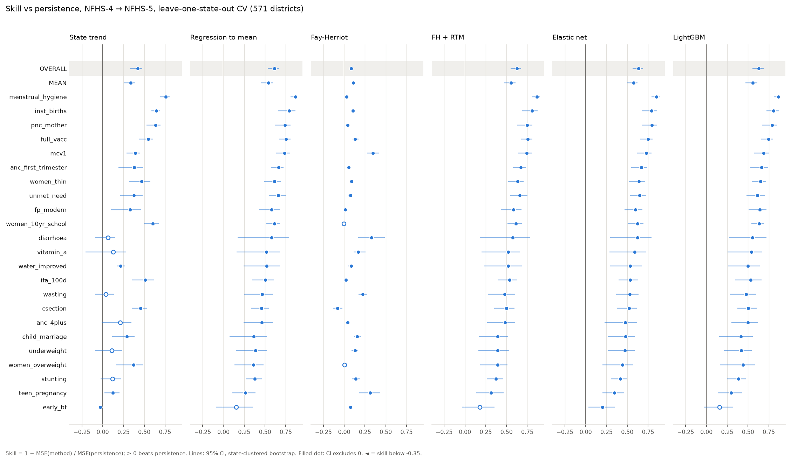
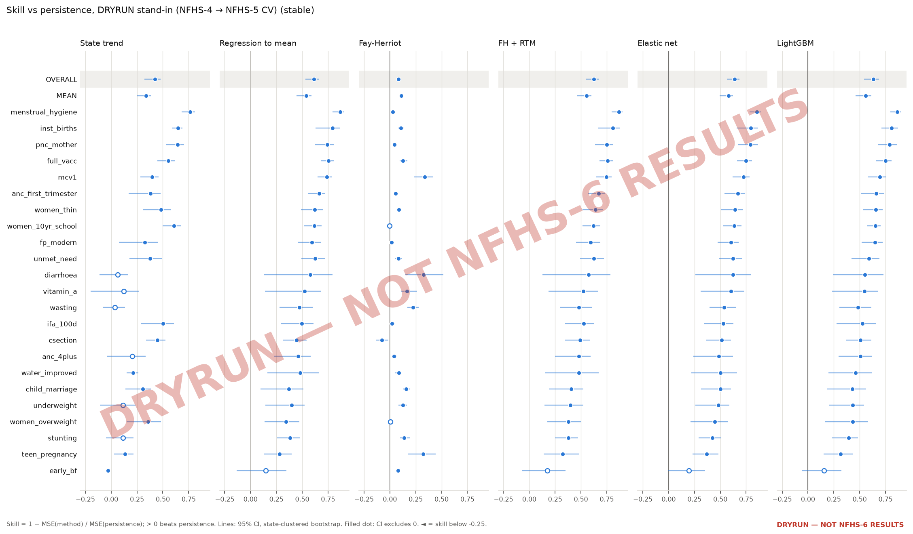
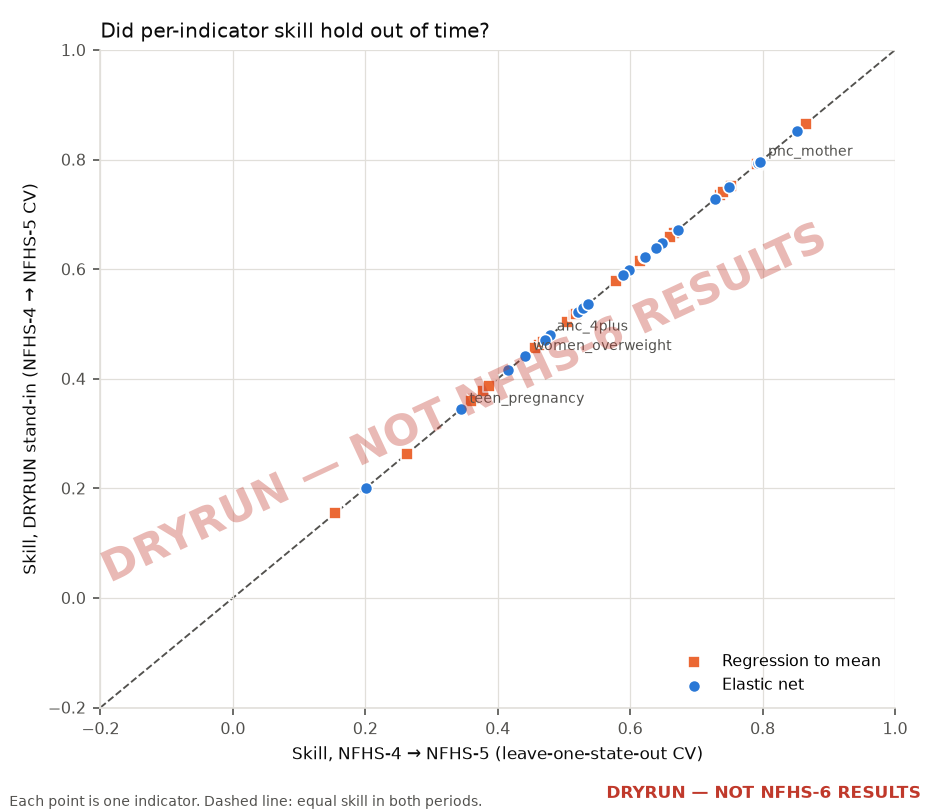
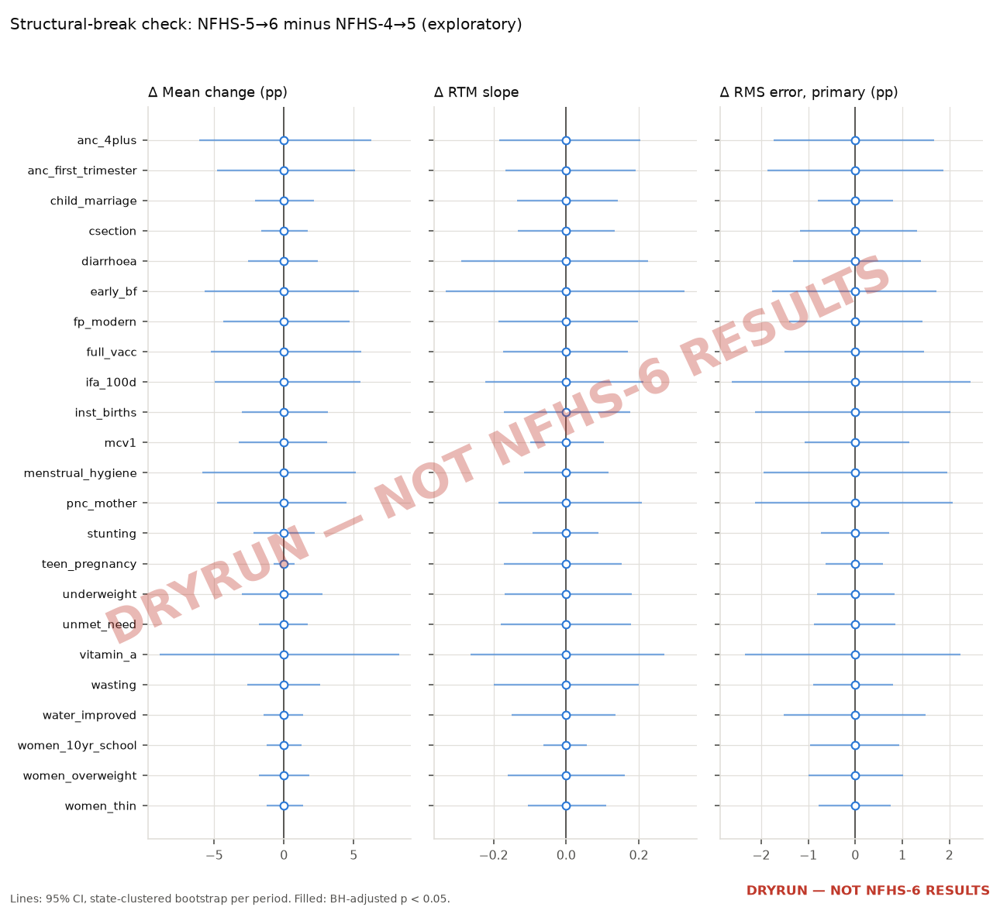
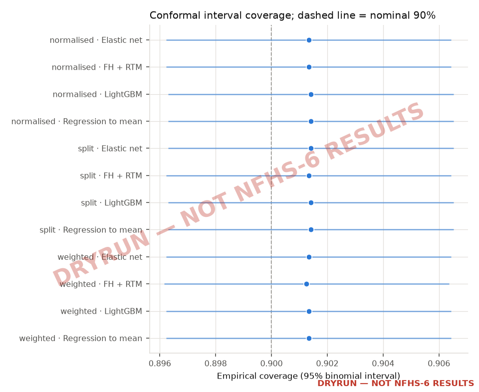
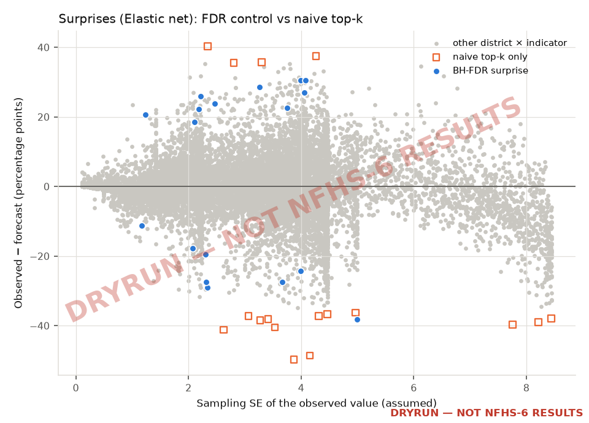
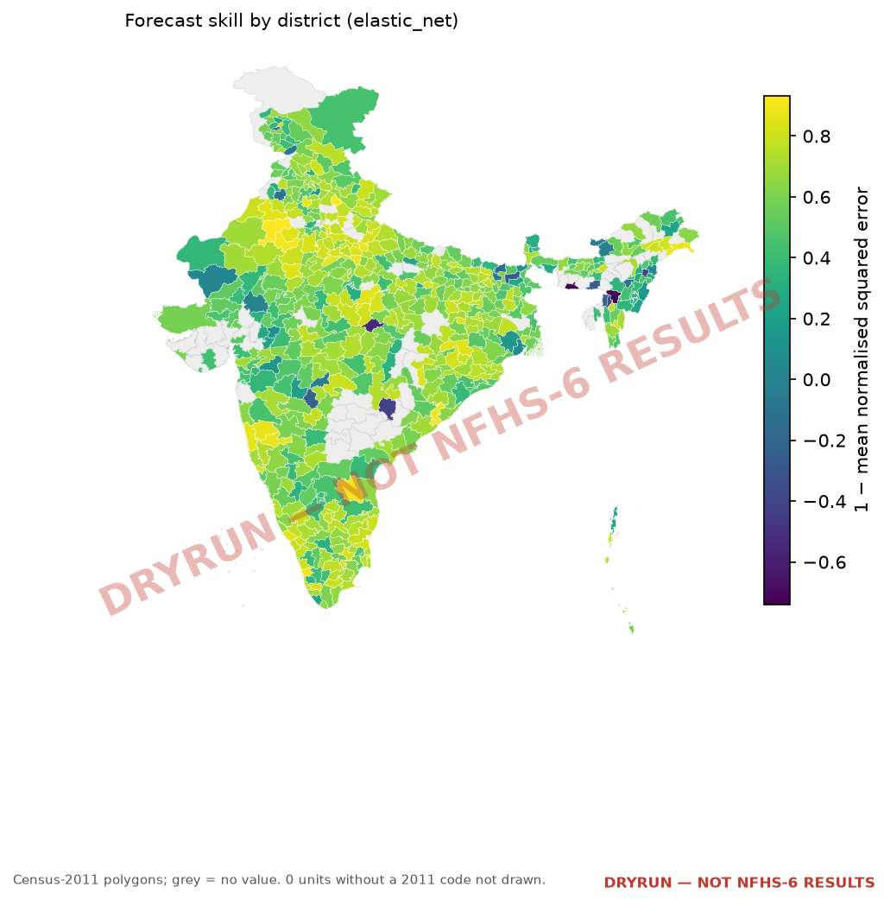
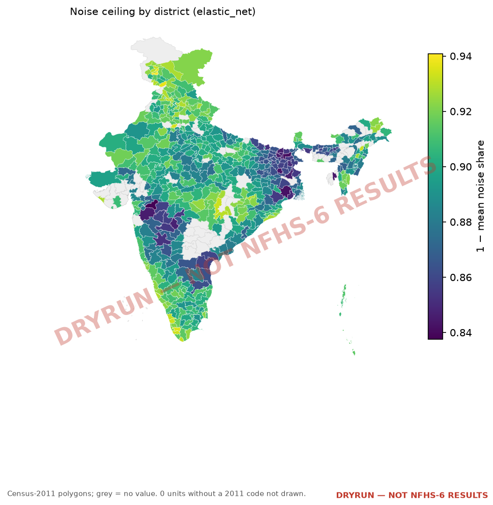

<!-- GENERATED by scripts/build_report.py (mode=dryrun) from docs/report_template.md. Edit the template, not this file. -->
# How Predictable Are District Health Outcomes? A Noise-Aware, Out-of-Time Test of Forecasting and Programme Surprise on India's NFHS-6

Team CodeFlow: Saurav S, Shikshith V, Thijl Thejaswi MN, Vishwas V Angadi.

<!--slot:run_status-->**DRYRUN — NOT NFHS-6 RESULTS.** The 'NFHS-6' numbers in this file come from the NFHS-4 → NFHS-5 leave-one-state-out predictions used as a stand-in, only to test the report pipeline.<!--/slot-->

Every result in this report is inserted from a result file by `scripts/build_report.py` and checked by
`scripts/check_report_numbers.py`; the source of each number is listed in `docs/report_values.json`.
Decisions are numbered as in `DECISIONS.md` (D01–D38). Analyses marked *exploratory* were added after the
pre-registrations D32 and D34.

## Abstract

District estimates from India's National Family Health Survey (NFHS) guide programme targeting, yet each
rests on a small sample and the next round arrives years later. We ask how far district outcomes can be
forecast one round ahead, and whether that depends on the indicator and the district rather than only on
the model. We trained forecasting models on the NFHS-4 (2015-16) → NFHS-5 (2019-21) transition, froze them
(training-data hash `<!--slot:train_hash-->d3f06bee428deeef<!--/slot-->`), and scored them once against NFHS-6 (2023-24). Boundary changes
were harmonised through a lineage crosswalk (<!--slot:n_train-->571<!--/slot--> training districts, <!--slot:n_test-->684<!--/slot--> test units).

In leave-one-state-out cross-validation on NFHS-4 → NFHS-5, regression to the mean (RTM) reached a pooled
skill of <!--slot:s45_rtm-->0.613<!--/slot--> over persistence, and an elastic net with spatial-neighbour features reached
<!--slot:s45_en-->0.637<!--/slot-->, with <!--slot:v45_en_rtm-->significantly lower MSE than<!--/slot--> RTM in pooled error, but it was significantly better on only <!--slot:n45_en_better-->2<!--/slot--> of <!--slot:n_ind-->23<!--/slot-->
indicators after false-discovery-rate control. On the out-of-time NFHS-6 test the pre-registered primary
method (<!--slot:primary_method-->Elastic net<!--/slot-->) reached a pooled skill of <!--slot:s56_primary-->0.637<!--/slot--> (RTM <!--slot:s56_rtm-->0.613<!--/slot-->), and the elastic net
had <!--slot:v56_en_rtm-->significantly lower MSE than<!--/slot--> RTM. Conformal 90% intervals calibrated on NFHS-4 → NFHS-5 covered <!--slot:cov_split-->0.901<!--/slot-->
(split) and <!--slot:cov_weighted-->0.901<!--/slot--> (shift-weighted) of NFHS-6 values. <!--slot:n_surprises-->18<!--/slot--> district-indicator pairs
were flagged as surprises at a 10% false-discovery rate.

## 1. Motivation

Indian health programmes are increasingly targeted at districts: the Aspirational Districts Programme
ranks districts on NFHS-type indicators, and state plans set district targets. A forecast of where a
district will be at the next survey is useful in two ways. It sets a benchmark against which a district's
measured change can be judged ("surprise"), and its accuracy tells planners how much of district
variation is predictable at all. Both uses fail if sampling noise is ignored: a district estimate based
on a few hundred respondents moves by several percentage points between rounds even when nothing
changes. This project therefore treats noise as part of the question. It asks how much skill is
possible given the noise (a noise ceiling), whether uncertainty intervals stay honest when the world
shifts between survey rounds, and which districts and indicators are forecastable.

The central claim tested is that **forecastability is a property of an indicator and a district, not
only of a model**.

## 2. Related work

*Small-area estimation.* District survey estimates are a classic small-area problem. The Fay–Herriot
area-level model (Fay & Herriot, 1979) and empirical-Bayes shrinkage (Efron & Morris, 1975) borrow
strength across areas; Rao & Molina (2015) review the field. We use the Fay–Herriot model as a denoiser
of the starting value.

*Regression to the mean.* Extreme district values tend to move toward the mean at the next measurement
partly because of sampling noise (Barnett, van der Pols & Dobson, 2005). A simple RTM regression is
therefore a strong baseline, and beating it is the relevant test for machine learning.

*Forecast evaluation.* We follow the out-of-sample, skill-score tradition (Hyndman & Athanasopoulos,
2021; Gneiting & Raftery, 2007) and compare methods with paired tests of loss differences in the spirit of
Diebold & Mariano (1995), using a state-clustered bootstrap. The ML methods are the elastic net (Zou &
Hastie, 2005) and gradient boosting with LightGBM (Ke et al., 2017).

*Uncertainty and surprise.* Conformal prediction gives distribution-free intervals (Vovk, Gammerman &
Shafer, 2005; Lei et al., 2018); weighted conformal prediction corrects for covariate shift (Tibshirani
et al., 2019). Surprise detection is a multiple-testing problem; we control the false-discovery rate
(Benjamini & Hochberg, 1995) and also compute conformal p-values (Bates et al., 2023).

*Pre-registration.* Fixing analyses before outcomes are seen guards against forking paths (Nosek et al.,
2018). Here the frozen models, the methods and the post-test analyses were committed to git before the
NFHS-6 evaluation, and the one-shot run is enforced in code.

## 3. Data

- **NFHS-4 and NFHS-5:** district values parsed from the IIPS NFHS-5 district fact sheets, which print
  the comparable NFHS-4 value beside each NFHS-5 value (community file `India.csv`).
- **NFHS-6:** the provisional IIPS State and District Fact Sheets (2023-24), in a community compilation
  (Patra, 2026). These values are provisional and were parsed from PDFs by a third party (section 11).
- **Cleaning and matching** (D05–D13): suppressed cells, the zero encoding of `India.csv`, name variants
  and indicator text are handled in code; indicators are matched across rounds by normalised text. The
  two copies of NFHS-5 (India.csv and the NFHS-6 file's own NFHS-5 column) were audited against each
  other; indicators and districts that disagree were excluded (D12).
- **Indicators:** <!--slot:n_ind-->23<!--/slot--> percentage indicators in five domains (water and sanitation, women's
  empowerment and family planning, maternal care, child health, nutrition), chosen from NFHS-4/5
  coverage and comparability only (D14).

## 4. Boundary harmonisation

District boundaries changed between all three rounds. A lineage crosswalk records every parent → child
link with its source and a confidence level (D27–D31, `outputs/crosswalk.csv`). The used links form a
bipartite graph between NFHS-5 and NFHS-6 districts; each connected component is one analysis unit.

- **Training set (NFHS-4 → NFHS-5):** <!--slot:n_train-->571<!--/slot--> districts whose NFHS-4 and NFHS-5 values refer to the
  same boundaries (<!--slot:n_train_added-->24<!--/slot--> more than the base pipeline's stable set).
- **Test set (NFHS-5 → NFHS-6):** <!--slot:n_test-->684<!--/slot--> units. Besides the stable districts it contains
  <!--slot:n_test_changed45-->121<!--/slot--> districts whose boundary changed between NFHS-4 and NFHS-5 but not afterwards, and
  <!--slot:n_test_inherited-->16<!--/slot--> districts that kept their name but lost territory in NFHS-6. The latter are scored
  against the forecast for the whole NFHS-5 district, carry extra variance and are flagged.
- **Stable-boundary subset:** <!--slot:n_stable-->547<!--/slot--> districts with identical boundaries in all three rounds. Every
  result is reported on it as well.
- **Not resolved:** <!--slot:n_review-->165<!--/slot--> cases are listed for review: <!--slot:n_rev_45-->132<!--/slot--> districts that changed between
  NFHS-4 and NFHS-5 (no NFHS-4 value on their boundaries, so they cannot be used for training),
  <!--slot:n_rev_new-->16<!--/slot--> new NFHS-6 districts whose parent is not recorded in the available data,
  <!--slot:n_rev_retained-->16<!--/slot--> retained-name boundary changes, and <!--slot:n_rev_low-->1<!--/slot--> low-confidence inferred parent.
  No lineage was invented: official Local Government Directory lineage could not be obtained
  automatically.

## 5. Noise model

Fact sheets do not publish sample sizes, so standard errors are **assumed**:
SE = 100·√(p(1−p)/n·deff), with per-district n by population group and design effect 2.0 (sensitivity
1.5–3.0; D16). Values inherited across a boundary change carry extra variance equal to 0.25 (remnant) or
0.5 (carved-out child) of the within-state between-district variance estimated on NFHS-5 (D29). These SEs
drive the noise ceiling, Fay–Herriot shrinkage, the normalised conformal scores and the surprise test,
so every noise-based statement inherits this assumption.

## 6. Methods

All methods predict round t+1 from round-t data only and were fitted on NFHS-4 → NFHS-5 only.

| Family | Methods |
|---|---|
| Baselines | persistence; national trend (mean change); state trend (state mean change); RTM (OLS of y_{t+1} on y_t) |
| Small-area | Fay–Herriot with state effects (REML); RTM on Fay–Herriot-denoised inputs (FH + RTM) |
| Machine learning | elastic net and LightGBM predicting the change, with own history, other indicators, spatial-neighbour features, state mean, region and state dummies |
| Ablations | own history only; + other indicators; + spatial features; full; full without state dummies |

**Validation.** Leave-one-state-out (LOSO) cross-validation is primary. A seen-state CV, in which held-out
districts' states appear in training, is reported as an optimistic reference because it exercises the
state dummies as the NFHS-6 test does, but shares each state's transition-specific shock.

**Metrics.** Skill = 1 − MSE(method)/MSE(persistence), pooled over indicators and as an unweighted mean
over indicators, with 95% state-clustered bootstrap intervals. Secondary metrics: skill net of the
national shift, the share of the variance of change that is sampling noise, and the noise ceiling
relative to persistence and to RTM.

## 7. Pre-registered analyses

Committed before any result they govern (verified by `scripts/preflight.py`):

- **D32 (models, tests, metrics).** The method list above; paired state-clustered bootstrap tests of
  ΔMSE against RTM for the elastic net, LightGBM and both no-state-dummy variants, with
  Benjamini–Hochberg adjustment across indicators; the secondary metrics; seen-state CV as a reference.
- **D34 (after the test).** Primary method = lowest pooled LOSO error on NFHS-4 → NFHS-5 (selected:
  <!--slot:primary_method-->Elastic net<!--/slot-->). Conformal intervals at 90% in three variants (split, normalised by origin SE,
  covariate-shift weighted) calibrated on NFHS-4 → NFHS-5 residuals. Surprises: residual scaled by
  forecast-error plus sampling variance, BH at q = 0.1, compared with a naive top-k. Per-district noise
  ceiling and a district-versus-indicator decomposition of forecast error.
- **Exploratory, added after D32/D34 (D37).** Results by unit group (flagged rows separately), the
  comparison of NFHS-4 → NFHS-5 with NFHS-5 → NFHS-6 skill, and a structural-break check.

## 8. Results on NFHS-4 → NFHS-5 (cross-validation)

### 8.1 Skill

<!--slot:t45_main-->| Method | Pooled skill | 95% CI | Mean skill over indicators | Pooled skill, stable subset |
|---|---|---|---|---|
| Persistence | 0.000 | [0.000, 0.000] | 0.000 | 0.000 |
| National trend | 0.422 | [0.326, 0.478] | 0.337 | 0.422 |
| State trend | 0.422 | [0.326, 0.478] | 0.337 | 0.422 |
| Regression to the mean (RTM) | 0.613 | [0.535, 0.672] | 0.540 | 0.613 |
| Fay-Herriot | 0.083 | [0.071, 0.098] | 0.108 | 0.085 |
| FH + RTM | 0.624 | [0.551, 0.678] | 0.554 | 0.624 |
| Elastic net | 0.637 | [0.566, 0.690] | 0.577 | 0.639 |
| LightGBM | 0.630 | [0.552, 0.687] | 0.557 | 0.630 |
| Elastic net, no state dummies | 0.625 | [0.554, 0.677] | 0.565 | 0.623 |
| LightGBM, no state dummies | 0.627 | [0.553, 0.682] | 0.556 | 0.626 |
| State trend (oracle) | 0.601 | [0.535, 0.647] | 0.510 | 0.597 |<!--/slot-->

National trend alone reaches <!--slot:s45_nat-->0.422<!--/slot-->, so a large part of the skill of every trend-aware method is the
average change between rounds. RTM reaches <!--slot:s45_rtm-->0.613<!--/slot--> (mean over indicators <!--slot:s45_rtm_mean-->0.540<!--/slot-->); the
elastic net <!--slot:s45_en-->0.637<!--/slot--> (mean <!--slot:s45_en_mean-->0.577<!--/slot-->) and LightGBM <!--slot:s45_lgbm-->0.630<!--/slot-->. Knowing each state's own change
(oracle, not a forecast) gives <!--slot:s45_oracle-->0.601<!--/slot-->, no better than RTM. Fay–Herriot denoising alone adds
little (<!--slot:s45_fh-->0.083<!--/slot-->; <!--slot:fh_deff15-->0.067<!--/slot--> to <!--slot:fh_deff3-->0.105<!--/slot--> across design effects 1.5–3.0) because it adds no trend.
On the stable subset the elastic net reaches <!--slot:s45_en_stable-->0.639<!--/slot--> and RTM <!--slot:s45_rtm_stable-->0.613<!--/slot-->.

<!--slot:fig45_skill--><!--/slot-->

### 8.2 Is machine learning better than RTM?

<!--slot:t45_paired-->| Comparison | Indicators better (raw) | Significantly better (BH) | Significantly worse (BH) | Pooled ΔMSE | 95% CI | p |
|---|---|---|---|---|---|---|
| Elastic net vs RTM | 19 | 2 | 0 | -4.93 | [-7.71, -2.00] | 0.000 |
| LightGBM vs RTM | 16 | 0 | 0 | -3.44 | [-8.29, 1.77] | 0.186 |
| Elastic net (no state dummies) vs RTM | 15 | 0 | 0 | -2.45 | [-6.24, 1.20] | 0.210 |
| LightGBM (no state dummies) vs RTM | 15 | 0 | 0 | -2.80 | [-7.68, 2.38] | 0.274 |<!--/slot-->

Pooled over indicators, the elastic net has <!--slot:v45_en_rtm-->significantly lower MSE than<!--/slot--> RTM (ΔMSE <!--slot:d45_en_rtm-->-4.93<!--/slot-->, 95% CI
[<!--slot:d45_en_rtm_lo-->-7.71<!--/slot-->, <!--slot:d45_en_rtm_hi-->-2.00<!--/slot-->]), but after Benjamini–Hochberg adjustment it is significantly
better on only <!--slot:n45_en_better-->2<!--/slot--> of <!--slot:n_ind-->23<!--/slot--> indicators (<!--slot:n45_en_better_stable-->4<!--/slot--> on the stable subset).
LightGBM has <!--slot:v45_lgbm_rtm-->no significant difference in MSE from<!--/slot--> RTM. The gain is real but thin.

### 8.3 What do the features add?

<!--slot:t45_ablation-->| Feature set | Pooled skill | Mean skill |
|---|---|---|
| Elastic net, own history | 0.611 | 0.538 |
| Elastic net, + other indicators | 0.611 | 0.541 |
| Elastic net, + spatial | 0.632 | 0.568 |
| Elastic net | 0.637 | 0.577 |
| Elastic net, no state dummies | 0.625 | 0.565 |
| LightGBM, own history | 0.594 | 0.517 |
| LightGBM, + other indicators | 0.597 | 0.520 |
| LightGBM, + spatial | 0.619 | 0.549 |
| LightGBM | 0.630 | 0.557 |
| LightGBM, no state dummies | 0.627 | 0.556 |<!--/slot-->

Other indicators add nothing beyond a district's own history; spatial-neighbour features carry the
gain over RTM, and state dummies add little in LOSO, where they cannot be exercised.

### 8.4 Noise and the national shift

<!--slot:t45_secondary-->| Method | Skill vs persistence | Skill net of national shift | 95% CI | Skill vs RTM |
|---|---|---|---|---|
| Regression to the mean (RTM) | 0.613 | 0.330 | [0.252, 0.396] | 0.000 |
| FH + RTM | 0.624 | 0.350 | [0.280, 0.406] | 0.029 |
| Elastic net | 0.637 | 0.373 | [0.308, 0.424] | 0.064 |
| LightGBM | 0.630 | 0.360 | [0.293, 0.419] | 0.044 |<!--/slot-->

Sampling noise is <!--slot:noise_share_45-->24.4%<!--/slot--> of the variance of district change (pooled; mean over indicators
<!--slot:noise_share_45_mean-->31.7%<!--/slot-->). The noise ceiling is <!--slot:ceil_p_45-->0.933<!--/slot--> relative to persistence but <!--slot:ceil_rtm_45-->0.828<!--/slot-->
relative to RTM: a perfect forecaster of the true value could remove at most that share of RTM's error.

### 8.5 Seen-state reference

When states are seen in training, the elastic net reaches <!--slot:s45_seen_en-->0.763<!--/slot--> (without state dummies
<!--slot:s45_seen_en_nostate-->0.692<!--/slot-->), RTM <!--slot:s45_seen_rtm-->0.637<!--/slot--> and state trend <!--slot:s45_seen_st-->0.597<!--/slot-->. The jump comes from state
dummies learning the same transition's state shocks, which a real forecast cannot know; LOSO is the
honest estimate.

### 8.6 Development check of the post-test tools

On NFHS-4 → NFHS-5 alone (calibration on half of the states, evaluation on the other half), 90% split
conformal intervals for the elastic net covered <!--slot:dev_cov_split-->0.877<!--/slot--> and shift-weighted intervals
<!--slot:dev_cov_weighted-->0.885<!--/slot-->.

## 9. Out-of-time test on NFHS-6

The frozen models predicted NFHS-6 from NFHS-5 once. Test units: <!--slot:n56-->571<!--/slot--> (<!--slot:n56_stable-->547<!--/slot--> stable,
<!--slot:n56_changed-->13<!--/slot--> changed between NFHS-4 and NFHS-5, <!--slot:n56_flagged-->11<!--/slot--> flagged).

### 9.1 Skill

<!--slot:t56_main-->| Method | Pooled skill | 95% CI | Mean skill over indicators | Pooled skill, stable subset |
|---|---|---|---|---|
| Persistence | 0.000 | [0.000, 0.000] | 0.000 | 0.000 |
| National trend | 0.422 | [0.325, 0.478] | 0.337 | 0.422 |
| State trend | 0.422 | [0.325, 0.478] | 0.337 | 0.422 |
| Regression to the mean (RTM) | 0.613 | [0.535, 0.672] | 0.540 | 0.614 |
| Fay-Herriot | 0.083 | [0.071, 0.098] | 0.108 | 0.082 |
| FH + RTM | 0.624 | [0.551, 0.678] | 0.554 | 0.624 |
| Elastic net | 0.637 | [0.566, 0.690] | 0.577 | 0.639 |
| LightGBM | 0.630 | [0.552, 0.687] | 0.557 | 0.632 |
| Elastic net, no state dummies | 0.625 | [0.554, 0.677] | 0.565 | 0.626 |
| LightGBM, no state dummies | 0.627 | [0.554, 0.682] | 0.556 | 0.628 |<!--/slot-->

The primary method (<!--slot:primary_method-->Elastic net<!--/slot-->) reached a pooled skill of <!--slot:s56_primary-->0.637<!--/slot--> (95% CI
[<!--slot:s56_primary_lo-->0.566<!--/slot-->, <!--slot:s56_primary_hi-->0.690<!--/slot-->]; stable subset <!--slot:s56_primary_stable-->0.639<!--/slot-->). National trend reached
<!--slot:s56_nat-->0.422<!--/slot-->, state trend <!--slot:s56_st-->0.422<!--/slot--> and RTM <!--slot:s56_rtm-->0.613<!--/slot-->.

<!--slot:fig56_skill--><!--/slot-->

<!--slot:fig56_skill_stable--><!--/slot-->

### 9.2 Results by unit group (exploratory)

Flagged units are scored against inherited forecasts and are shown separately.

<!--slot:t56_groups-->| Subset | Districts | RTM skill | Primary-method skill | Mean skill, primary |
|---|---|---|---|---|
| harmonised set (all) | 571 | 0.613 | 0.637 | 0.577 |
| stable-boundary subset | 547 | 0.614 | 0.639 | 0.578 |
| identity, boundary changed NFHS-4→5 | 13 | 0.326 | 0.298 | -0.004 |
| flagged (inherited / aggregated) | 11 | 0.751 | 0.787 | 0.627 |<!--/slot-->

### 9.3 Machine learning versus RTM

<!--slot:t56_paired-->| Comparison | Significantly better (BH) | Significantly worse (BH) | Pooled ΔMSE | 95% CI | p |
|---|---|---|---|---|---|
| Elastic net vs RTM | 2 | 0 | -4.93 | [-7.71, -2.00] | 0.000 |
| LightGBM vs RTM | 0 | 0 | -3.44 | [-8.29, 1.77] | 0.186 |
| Elastic net (no state dummies) vs RTM | 0 | 0 | -2.45 | [-6.24, 1.20] | 0.210 |
| LightGBM (no state dummies) vs RTM | 0 | 0 | -2.80 | [-7.68, 2.38] | 0.274 |<!--/slot-->

On NFHS-6 the elastic net had <!--slot:v56_en_rtm-->significantly lower MSE than<!--/slot--> RTM (stable subset: <!--slot:v56_en_rtm_stable-->significantly lower MSE than<!--/slot--> RTM), and
LightGBM had <!--slot:v56_lgbm_rtm-->no significant difference in MSE from<!--/slot--> RTM.

### 9.4 Noise and the national shift

<!--slot:t56_secondary-->| Method | Skill net of national shift | 95% CI | Skill vs RTM |
|---|---|---|---|
| National trend | 0.000 | [0.000, 0.000] | -0.493 |
| State trend | 0.000 | [0.000, 0.000] | -0.493 |
| Regression to the mean (RTM) | 0.330 | [0.252, 0.396] | 0.000 |
| FH + RTM | 0.350 | [0.280, 0.406] | 0.029 |
| Elastic net | 0.373 | [0.308, 0.424] | 0.064 |
| LightGBM | 0.360 | [0.293, 0.419] | 0.044 |<!--/slot-->

Sampling noise was <!--slot:noise_share_56-->24.4%<!--/slot--> of the variance of change, and the noise ceiling relative to RTM
was <!--slot:ceil_rtm_56-->0.828<!--/slot-->.

### 9.5 Did cross-validation predict the test? (exploratory)

<!--slot:t56_compare-->| Method | Skill 4→5 (CV) | Skill 5→6 (test) | Change |
|---|---|---|---|
| Persistence | 0.000 | 0.000 | 0.000 |
| National trend | 0.422 | 0.422 | -0.000 |
| State trend | 0.422 | 0.422 | -0.000 |
| Regression to the mean (RTM) | 0.613 | 0.613 | 0.000 |
| Fay-Herriot | 0.083 | 0.083 | -0.000 |
| FH + RTM | 0.624 | 0.624 | 0.000 |
| Elastic net | 0.637 | 0.637 | -0.000 |
| LightGBM | 0.630 | 0.630 | 0.000 |
| Elastic net, no state dummies | 0.625 | 0.625 | -0.000 |
| LightGBM, no state dummies | 0.627 | 0.627 | 0.000 |<!--/slot-->

The rank correlation of methods' pooled skill between the two periods is <!--slot:cmp_spearman_methods-->1.00<!--/slot-->; the
best method was <!--slot:cmp_best45-->Elastic net<!--/slot--> in cross-validation and <!--slot:cmp_best56-->Elastic net<!--/slot--> on NFHS-6. Across indicators, the
primary method's skill in the two periods correlates at <!--slot:cmp_spearman_ind-->1.00<!--/slot--> (Spearman).

<!--slot:fig56_compare--><!--/slot-->

### 9.6 Structural-break check (exploratory)

Comparing NFHS-5 → NFHS-6 with NFHS-4 → NFHS-5 per indicator, <!--slot:breaks_any-->0<!--/slot--> indicators show a
significant change in at least one of: the mean change (<!--slot:breaks_shift-->0<!--/slot-->), the RTM slope
(<!--slot:breaks_slope-->0<!--/slot-->) or the primary method's error scale (<!--slot:breaks_scale-->0<!--/slot-->) (BH q = 0.05).

<!--slot:t56_breaks-->*(none)*<!--/slot-->

<!--slot:fig56_break--><!--/slot-->

## 10. Uncertainty, surprise and forecastability on NFHS-6

### 10.1 Conformal coverage

<!--slot:t56_coverage-->| Variant · method | n | Coverage | Mean width (pp) |
|---|---|---|---|
| normalised · Elastic net | 13105 | 0.901 | 24.7 |
| normalised · FH + RTM | 13105 | 0.901 | 25.2 |
| normalised · LightGBM | 13105 | 0.901 | 25.0 |
| normalised · Regression to the mean (RTM) | 13105 | 0.901 | 25.4 |
| split · Elastic net | 13105 | 0.901 | 25.0 |
| split · FH + RTM | 13105 | 0.901 | 25.5 |
| split · LightGBM | 13105 | 0.901 | 25.4 |
| split · Regression to the mean (RTM) | 13105 | 0.901 | 25.9 |
| shift-weighted · Elastic net | 13105 | 0.901 | 25.0 |
| shift-weighted · FH + RTM | 13105 | 0.901 | 25.5 |
| shift-weighted · LightGBM | 13105 | 0.901 | 25.4 |
| shift-weighted · Regression to the mean (RTM) | 13105 | 0.901 | 25.9 |<!--/slot-->

For the primary method, nominal 90% intervals covered <!--slot:cov_split-->0.901<!--/slot--> (split), <!--slot:cov_normalised-->0.901<!--/slot-->
(normalised) and <!--slot:cov_weighted-->0.901<!--/slot--> (shift-weighted) of NFHS-6 values.

<!--slot:fig56_coverage--><!--/slot-->

### 10.2 Surprises

Of <!--slot:n_surprise_tests-->13096<!--/slot--> district-indicator pairs, <!--slot:n_surprises-->18<!--/slot--> are surprises at a false-discovery rate
of 10%. A naive list of the <!--slot:naive_k-->18<!--/slot--> largest residuals shares <!--slot:surprise_overlap-->1<!--/slot--> of them; its picks
have a mean assumed SE of <!--slot:naive_se-->4.44<!--/slot--> against <!--slot:bh_se-->2.90<!--/slot--> for the FDR-controlled list, i.e. the naive list
favours noisy districts.

<!--slot:t56_surprises-->| District · indicator | Forecast | Observed | z | BH q | Unit type |
|---|---|---|---|---|---|
| chhattisgarh|bijapur · women_thin | 17.6 | 43.6 | 6.33 | 0.000 | identity |
| assam|cachar · water_improved | 72.9 | 43.8 | -6.19 | 0.000 | identity |
| assam|hailakandi · water_improved | 68.6 | 41.2 | -5.85 | 0.000 | identity |
| bihar|supaul · diarrhoea | 8.8 | 39.3 | 5.78 | 0.000 | identity |
| nagaland|peren · water_improved | 71.9 | 92.5 | 4.84 | 0.003 | identity |
| assam|karimganj · wasting | 17.4 | 48.0 | 4.76 | 0.004 | identity |
| arunachal pradesh|west kameng · teen_pregnancy | 12.6 | 1.4 | -4.75 | 0.004 | identity |
| arunachal pradesh|tawang · inst_births | 55.6 | 84.2 | 4.56 | 0.008 | identity |
| bihar|madhubani · diarrhoea | 7.6 | 30.2 | 4.43 | 0.014 | identity |
| nagaland|mon · inst_births | 48.8 | 21.4 | -4.22 | 0.032 | identity |
| nagaland|zunheboto · underweight | 17.5 | 44.5 | 4.19 | 0.034 | identity |
| meghalaya|south garo hills · water_improved | 79.9 | 60.4 | -4.17 | 0.034 | identity |
| puducherry|mahe · csection | 51.7 | 27.5 | -4.10 | 0.041 | identity |
| chhattisgarh|kabeerdham · inst_births | 67.8 | 91.7 | 4.05 | 0.047 | identity |
| meghalaya|east khasi hills · unmet_need | 14.4 | 33.0 | 4.00 | 0.053 | identity |<!--/slot-->

<!--slot:fig56_surprises--><!--/slot-->

### 10.3 Forecastability: indicator or district?

In an additive decomposition of log normalised squared error, indicators alone explain
R² = <!--slot:r2_ind-->0.062<!--/slot-->, districts alone <!--slot:r2_dist-->0.078<!--/slot-->, and both together <!--slot:r2_add-->0.140<!--/slot-->.

Hardest indicators (lowest normalised skill):

<!--slot:t56_hard-->| Indicator | Noise ceiling | Normalised skill |
|---|---|---|
| early_bf | 0.943 | 0.201 |
| teen_pregnancy | 0.630 | 0.345 |
| stunting | 0.755 | 0.416 |
| women_overweight | 0.933 | 0.441 |
| underweight | 0.817 | 0.471 |
| anc_4plus | 0.956 | 0.477 |<!--/slot-->

<!--slot:fig56_map_skill--><!--/slot-->

<!--slot:fig56_map_ceiling--><!--/slot-->

## 11. Limitations

- **Assumed standard errors.** Sample sizes and design effects are assumptions (D16). The noise ceiling,
  Fay–Herriot shrinkage, normalised conformal scores and the surprise test all depend on them. The
  design-effect sensitivity is in `outputs/sensitivity_deff.csv`.
- **Provisional, community-parsed NFHS-6 data.** NFHS-6 values are provisional IIPS figures parsed from
  PDFs by a third party. An independent parser and a random spot-check against the official PDFs exist
  (`scripts/spot_check_nfhs6.py`, D33) but were **not run** because the PDFs were not in the repository;
  until they are, parsing errors in the NFHS-6 file cannot be excluded.
- **Partial harmonisation.** Only lineage supported by the available files was used. Districts that
  changed between NFHS-4 and NFHS-5 cannot be used for training, and they are not a random sample (D28).
  New NFHS-6 districts without a recorded parent are not scored. Inherited units are scored with an
  assumed extra variance (D29).
- **One training transition.** All models learned from a single transition, and much of the skill is
  the average national change; whether the 2015-16 → 2019-21 change pattern (with COVID-period fieldwork)
  carries over to 2019-21 → 2023-24 is exactly what section 9 tests.
- **Validation design.** LOSO does not exercise state effects, while the NFHS-6 test uses seen states;
  seen-state CV is optimistic.
- **Multiple comparisons beyond the pre-registration.** Exploratory analyses (D37) are not error-controlled
  across their own family and should be read as descriptive.

## 12. Future work

- **RQ5, Aspirational Districts:** comparing surprises in the programme's 112 districts with others needs
  the official district list and was out of scope.
- **Explanations and clustering:** SHAP values for the ML models and clustering of district trajectories.
- **Dashboard:** an interactive view of forecasts, intervals and surprises.
- **Full lineage:** official LGD lineage, district populations and NFHS-4 Census-2011 values would let the
  changed districts enter training and allow population-weighted aggregation (`data/lineage/README.md`).

## 13. Reproducibility

The training data and configuration are frozen in `outputs/models/` (training-data hash `<!--slot:train_hash-->d3f06bee428deeef<!--/slot-->`,
config hash `<!--slot:config_hash-->24e4b2befa146b0a<!--/slot-->`, <!--slot:n_methods-->16<!--/slot--> methods). Commands, in order: `scripts/run_pipeline.py`,
`scripts/preflight.py`, `scripts/gate_b.ps1` (runs the one-shot evaluation once), `scripts/post_run.py`.
The harmonised panel and codebook are released in `outputs/release/`. Every judgement call is in
`DECISIONS.md`.

## References

*Team: verify each reference against the original before submission.*

- Barnett, A. G., van der Pols, J. C., & Dobson, A. J. (2005). Regression to the mean: what it is and how to deal with it. *International Journal of Epidemiology*, 34(1), 215–220.
- Bates, S., Candès, E., Lei, L., Romano, Y., & Sesia, M. (2023). Testing for outliers with conformal p-values. *Annals of Statistics*, 51(1), 149–178.
- Benjamini, Y., & Hochberg, Y. (1995). Controlling the false discovery rate: a practical and powerful approach to multiple testing. *Journal of the Royal Statistical Society B*, 57(1), 289–300.
- Diebold, F. X., & Mariano, R. S. (1995). Comparing predictive accuracy. *Journal of Business & Economic Statistics*, 13(3), 253–263.
- Efron, B., & Morris, C. (1975). Data analysis using Stein's estimator and its generalizations. *Journal of the American Statistical Association*, 70(350), 311–319.
- Fay, R. E., & Herriot, R. A. (1979). Estimates of income for small places: an application of James-Stein procedures to census data. *Journal of the American Statistical Association*, 74(366), 269–277.
- Gneiting, T., & Raftery, A. E. (2007). Strictly proper scoring rules, prediction, and estimation. *Journal of the American Statistical Association*, 102(477), 359–378.
- Hyndman, R. J., & Athanasopoulos, G. (2021). *Forecasting: Principles and Practice* (3rd ed.). OTexts.
- International Institute for Population Sciences (IIPS) & ICF (2021). *National Family Health Survey (NFHS-5), 2019-21: India.* Mumbai: IIPS. District fact sheets: http://rchiips.org/nfhs/
- International Institute for Population Sciences (IIPS). *National Family Health Survey-6 (NFHS-6), 2023-24: State and District Fact Sheets* (provisional). Mumbai: IIPS.
- Ke, G., Meng, Q., Finley, T., Wang, T., Chen, W., Ma, W., Ye, Q., & Liu, T.-Y. (2017). LightGBM: a highly efficient gradient boosting decision tree. *Advances in Neural Information Processing Systems*, 30.
- Lei, J., G'Sell, M., Rinaldo, A., Tibshirani, R. J., & Wasserman, L. (2018). Distribution-free predictive inference for regression. *Journal of the American Statistical Association*, 113(523), 1094–1111.
- Nosek, B. A., Ebersole, C. R., DeHaven, A. C., & Mellor, D. T. (2018). The preregistration revolution. *Proceedings of the National Academy of Sciences*, 115(11), 2600–2606.
- Patra, N. K. (2026). *NFHS-6 Provisional District-Level Data (India): Independent Compilation* (v1.0.0). GitHub.
- Rao, J. N. K., & Molina, I. (2015). *Small Area Estimation* (2nd ed.). Wiley.
- Tibshirani, R. J., Barber, R. F., Candès, E. J., & Ramdas, A. (2019). Conformal prediction under covariate shift. *Advances in Neural Information Processing Systems*, 32.
- Vovk, V., Gammerman, A., & Shafer, G. (2005). *Algorithmic Learning in a Random World.* Springer.
- Zou, H., & Hastie, T. (2005). Regularization and variable selection via the elastic net. *Journal of the Royal Statistical Society B*, 67(2), 301–320.
